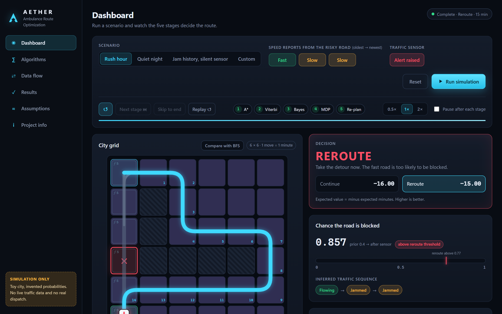
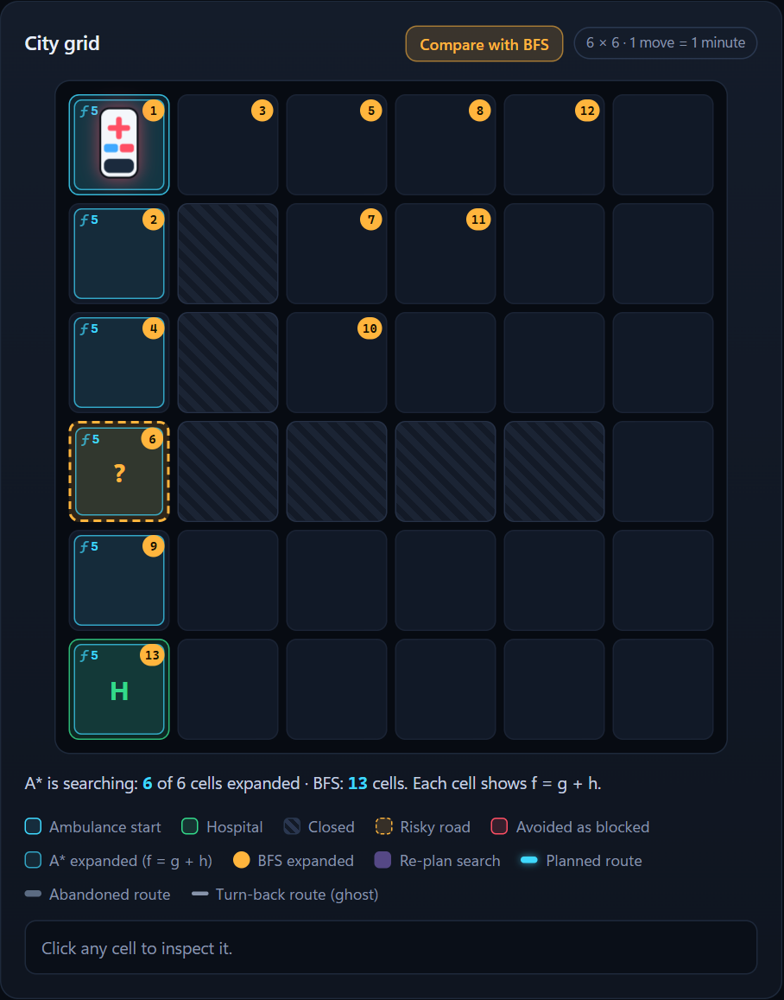
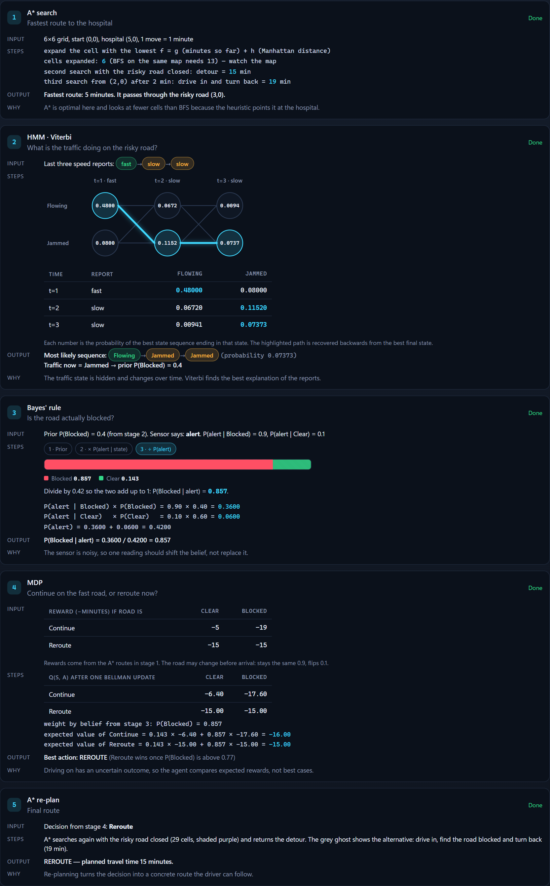
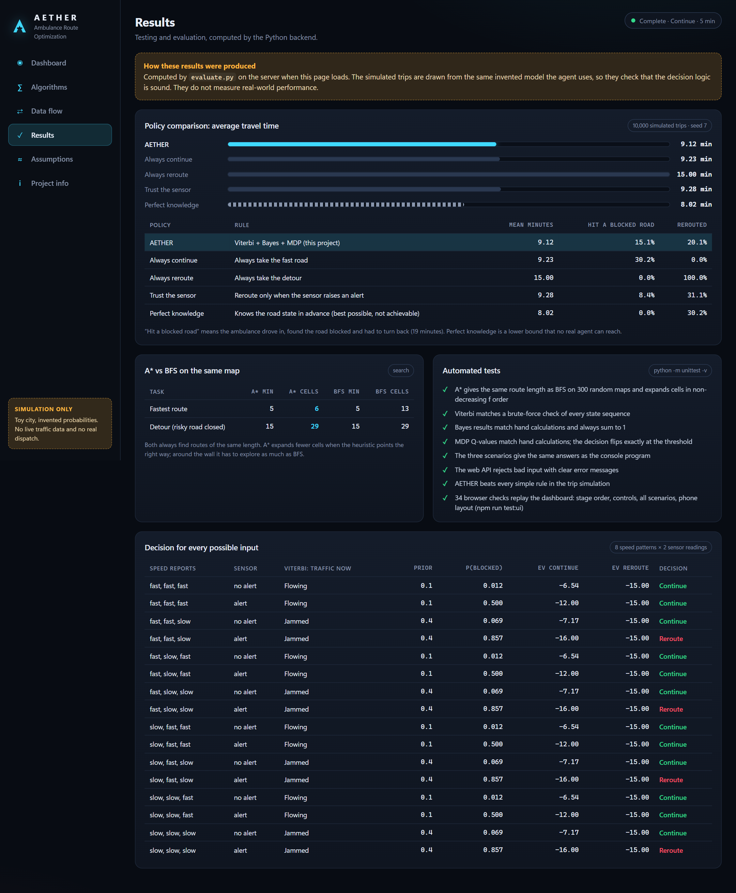
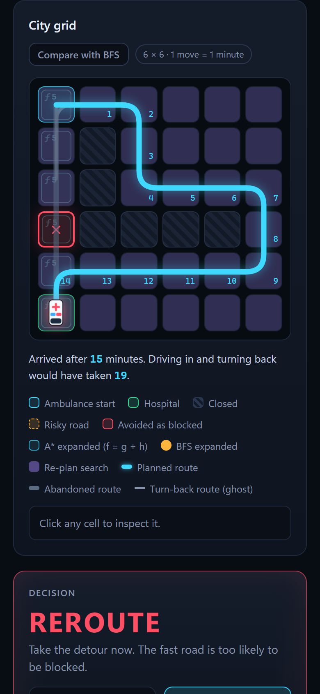

# AETHER — AI-Powered Ambulance Route Optimization System

[](https://github.com/BulagenZ/aether-ambulance/actions/workflows/tests.yml)

**AI Fundamentals · Final Project** · Individual project by **Bulabai Bakytzhanuly** ([BulagenZ](https://github.com/BulagenZ)), Group 2 · Instructors: Aizhan Sydykova, Dilnura Ali

The shortest road to the hospital may be blocked. Driving in and turning back costs minutes, while always taking the detour is slow. AETHER plans the routes, estimates how likely the road is blocked from noisy evidence, and decides whether the ambulance should **continue** or **reroute** before it commits. Four algorithms from the course work as one pipeline, and a web dashboard shows every step.

> **Simulation only.** The map, probabilities and rewards are invented for a teaching model. AETHER uses no real traffic data and is not connected to any emergency dispatch service.



## Deliverables

| Deliverable | Where |
|---|---|
| Working application | This repository: `run.bat` or `python app.py` (see [Quick start](#quick-start)) |
| Technical report | [docs/AETHER_Technical_Report.pdf](docs/AETHER_Technical_Report.pdf) ([Word version](docs/AETHER_Technical_Report.docx)) |
| Presentation (7 slides) | [docs/AETHER_Presentation.pptx](docs/AETHER_Presentation.pptx) |
| Demo video (2 min, captioned) | [docs/demo/AETHER_demo.mp4](docs/demo/AETHER_demo.mp4) |
| AI usage declaration | [docs/AI_Usage_Declaration.md](docs/AI_Usage_Declaration.md) |
| Team contribution statement | [docs/Team_Contribution_Statement.md](docs/Team_Contribution_Statement.md) |
| Screenshots | [docs/screenshots/](docs/screenshots/) |

## Quick start

Requires **Python 3.10 or newer** ([python.org](https://www.python.org/downloads/); tick *Add python.exe to PATH* during setup).

**Get the code:** click **Code → Download ZIP** above and unzip it, or clone it:

```bash
git clone https://github.com/BulagenZ/aether-ambulance.git
```

**Windows, one click:** open the folder and double-click `run.bat`. It installs Flask the first time, starts the server and opens the browser.

**Any system, from a terminal in this folder:**

```bash
python -m pip install -r requirements.txt
```

```bash
python app.py
```

Then open <http://127.0.0.1:5000>. Keep the terminal open while using the site; press `Ctrl+C` to stop. If port 5000 is busy, set another port first (Windows: `set PORT=5050`, macOS/Linux: `export PORT=5050`).

| Command | What it does |
|---|---|
| `python -m unittest -v` | Runs the 42 automated Python tests |
| `python evaluate.py` | Prints the evaluation: A* vs BFS, all 16 inputs, 10,000-trip policy comparison |
| `python main.py rush` | Console version (also `calm` and `mixed`) |
| `npm install` then `npm run test:ui` | Optional: 34 automated browser checks of the dashboard (needs Node.js and Chrome or Edge) |

## Using the dashboard

1. Pick a scenario — **Rush hour**, **Quiet night** or **Jam history, silent sensor** — or toggle the speed reports and sensor to build a **Custom** one.
2. Press **Run simulation**. The Python backend computes all five stages at once; the dashboard then plays them back as an animation:
   - **A\* search:** each expanded cell lights up in order with its `f = g + h`; turn on **Compare with BFS** to see BFS explore 13 cells for the same route.
   - **Route:** drawn as one line; a top-down ambulance follows it. When the agent reroutes, the blocked road shakes, A\* re-plans (purple cells), and a grey ghost drives the 19-minute turn-back route next to the real 15-minute detour.
   - **Viterbi:** a trellis fills in column by column and the best path is traced backwards.
   - **Bayes:** a bar shows prior → × likelihood → ÷ P(observation).
   - **MDP:** expected values count up and the decision appears; the gauge marks the 0.77 reroute threshold.
3. Control the playback: **▶ / ❚❚**, **Next stage**, **Skip to end**, **Replay**, the stage buttons **1–5** (jump to any stage, also backwards), speed **0.5× / 1× / 2×** and **Pause after each stage** (useful when presenting). Keyboard: **Space** = play/pause, **→** = next stage.
4. Click any map cell to inspect it (for example how A\* scored it). **Reset** clears the run.
5. The sidebar opens **Algorithms**, **Data flow** (packets carry the live values between algorithms), **Results**, **Assumptions** and **Project info**.

Animations use **Anime.js** (the run timeline) and **Motion** (counters, springs, page transitions). Both are copied into `static/vendor/`, so no build step or internet connection is needed. With the system's *reduce motion* setting on, results appear immediately.

## The algorithms and how they work together

| Stage | Algorithm (course topic) | Input | Output passed on |
|---|---|---|---|
| 1 | **A\* search** (Lecture 2: informed search) | 6×6 map, start, hospital | Fastest route 5 min, detour 15 min, turn-back cost 19 min |
| 2 | **HMM + Viterbi** (Lecture 7: hidden Markov models) | Three speed reports | Current traffic state → prior P(Blocked) |
| 3 | **Bayes' rule** (Lecture 6: probability and Bayesian networks) | Prior + one sensor reading | Posterior P(Blocked) |
| 4 | **MDP, Bellman update** (MDP and reinforcement learning) | P(Blocked) + travel times | Continue or Reroute |
| 5 | **A\* re-plan** | The decision | Final route |

The MDP's rewards are the A\* travel times, its belief is the Bayes posterior, the Bayes prior comes from Viterbi, and a Reroute decision makes A\* search again. Changing any input changes every later stage.

- **A\*** expands the cell with the lowest `f = g + h` (`g` = minutes so far, `h` = Manhattan distance). The heuristic never overestimates on a 4-direction grid, so the route is optimal.
- **Viterbi** finds the most likely hidden traffic sequence (Flowing/Jammed) by dynamic programming: `V_t(s) = max_p V_{t-1}(p)·T(p→s)·E(s,o_t)`.
- **Bayes' rule** updates the blockage probability: `P(B|obs) = P(obs|B)·P(B) / P(obs)`.
- **MDP:** one Bellman update `Q(s,a) = Σ T(s'|s,a)·[R(a,s') + γV(s')]`, weighted by the Bayes belief; the higher expected value wins.

## Results

| Scenario | Speed reports | Sensor | P(Blocked) | EV Continue | EV Reroute | Decision |
|---|---|---|---:|---:|---:|---|
| Rush hour | fast, slow, slow | alert | 0.857 | −16.00 | −15.00 | **Reroute** (15 min) |
| Quiet night | fast, fast, fast | none | 0.012 | −6.54 | −15.00 | **Continue** (5 min) |
| Jam history, silent sensor | slow, slow, slow | none | 0.069 | −7.17 | −15.00 | **Continue** (5 min) |

The agent reroutes only when P(Blocked) > 0.77.

**Policy comparison, 10,000 simulated trips (seed 7):**

| Policy | Mean minutes | Hit a blocked road |
|---|---:|---:|
| **AETHER** (Viterbi + Bayes + MDP) | **9.12** | 15.1% |
| Always continue | 9.23 | 30.2% |
| Trust the sensor (reroute on alert) | 9.28 | 8.4% |
| Always reroute | 15.00 | 0.0% |
| Perfect knowledge (lower bound) | 8.02 | 0.0% |

The trips are drawn from the same invented model the agent uses, so this checks that the decision logic is sound, not real-world performance. A\* expands 6 cells for the fastest route where BFS expands 13 (both find 5 minutes).

## Testing

`python -m unittest -v` runs **42 tests**, all passing:

- every algorithm against hand-computed values;
- A\* against BFS on 300 random maps, and Viterbi against a brute-force check of every state sequence;
- A\* expands cells in non-decreasing `f` order, and the search traces shown on the map never change the results;
- properties: Bayes posteriors sum to 1, and the MDP decision flips exactly at the threshold;
- the website returns exactly the same results as the console program for all three scenarios;
- the web API, including 7 kinds of invalid input (HTTP 400), unknown paths (404) and wrong methods (405);
- the evaluation: all 16 inputs covered, and AETHER beats every simple rule for three random seeds.

The Python tests run automatically on GitHub after every push, on Windows and Linux with Python 3.10 and 3.12 (see the badge at the top and the **Actions** tab).

`npm run test:ui` runs **34 browser checks** in headless Chrome against a live server: no stage shows its result early, every playback control works (including jumping backwards and resizing mid-run), all four scenarios give the backend's numbers, the pages and phone layout work, reduced motion shows the result at once, and there are no JavaScript errors.

## Project structure

```
astar.py  viterbi.py  bayes.py  mdp.py   the four algorithms (pure Python, standard library only)
bfs.py                                   BFS baseline used to evaluate A*
main.py                                  console program, the three scenarios and every assumed value
pipeline.py                              runs the five stages and returns all intermediate results (incl. search order)
evaluate.py                              testing and results: search comparison, all inputs, policy comparison
app.py                                   Flask server: page + JSON API with error handling
templates/index.html                     dashboard structure
static/app.js                            dashboard logic and the Anime.js playback timeline (draws backend results only)
static/fx.js, static/geo.js              Motion interface effects; map geometry for drawing routes
static/style.css                         design
static/vendor/                           Anime.js and Motion browser builds (from npm run vendor)
test_project.py  test_web.py  test_evaluation.py    42 automated Python tests
ui-test/run.js                           34 automated browser checks (npm run test:ui)
package.json                             front-end tool versions (not needed to run the site)
run.bat                                  one-click launcher for Windows
.github/workflows/tests.yml              runs the tests on GitHub after every push
docs/                                    report, slides, video, screenshots, declarations
```

## Web API

| Endpoint | Purpose |
|---|---|
| `GET /api/config` | Map, scenarios and every assumed value |
| `POST /api/simulate` | `{"scenario": "rush"}` (or `calm`, `mixed`), or `{"custom": {"speeds": ["fast","slow","slow"], "alert": true}}` |
| `GET /api/evaluate` | Search comparison, all 16 inputs, policy comparison |

Invalid input returns HTTP 400 with an `error` message.

## Screenshots

| A\* search compared with BFS | Viterbi trellis and Bayes bar |
|---|---|
|  |  |
| **Results** | **Phone layout** |
|  |  |

## Limitations and future work

- Only one road is uncertain; a real city needs a belief for every road.
- The numbers are invented; they could be learned from traffic data (classical ML, Lecture 8).
- The MDP looks one step ahead; value iteration over the whole trip would let the agent re-decide at every intersection.
- Viterbi passes on only the most likely state; the forward algorithm could pass the full belief.

## AI usage

This project was developed with the assistance of Claude (Anthropic). See [docs/AI_Usage_Declaration.md](docs/AI_Usage_Declaration.md).
